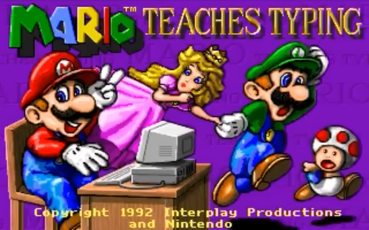

# Brooklyn Plumber Teaches Typing



Mario Teaches Typing, a 1992 MS-DOS classic, recreated as a browser game.

**[Play in your browser](https://brooklynplumberteachestyping.dad)**

Static HTML, CSS and JavaScript. Progress stays in your browser. No backend or accounts.

Ground up rebuild, not an emulator. And for legal purposes, this is satire.

## Run locally

```bash
npm ci
npm run preview:restart
```

Open [http://127.0.0.1:4173](http://127.0.0.1:4173).

## Development

- `npm test` checks shipped data and gameplay without local research.
- `npm run build` generates ignored `dist/`. GitHub Pages CI installs dependencies, tests, builds and uploads that directory.
- `npm run test:browser` checks the built site (stop the preview first, or set `PLAYWRIGHT_PORT` to a free port).
- Research, historical docs, source media and provenance are local-only under ignored `research/`; they are not needed to build or play.

Optional source checks require retained research: set `LESSON_RESEARCH_ROOT="$PWD/research/executable-1992"` for Node lesson comparisons and `ORIGINAL_FIDELITY_SOURCE="$PWD"` for Node asset and browser source-image comparisons. Missing files with these options enabled are errors, not silent skips. Offline importers and asset builders require their original inputs; CI never runs them.

See [art and rights](docs/ART.md), [renderer ownership](docs/RENDERER-CONTRACT.md) and [title behavior](docs/TITLE-SCREEN.md).

## Browser policies

This is an adaptation, not a claim of exact DOS behavior. All four activities remain accessible. Original lesson records are preferred where their required keys fit; incompatible records and unresolved practice wrapping use labeled generated text. Historical wording is retained with a notice and generated alternatives in Help.

The engine owns scoring and active time; course progression requires explicit Next. Early deaths are disabled. Local student migration preserves old saves and earned history rather than overwriting them. Current behavior is specified by `tests/engine.test.js`, `tests/course.test.js`, `tests/lessons.test.js` and `tests/storage.test.js`, not archived phase plans.
